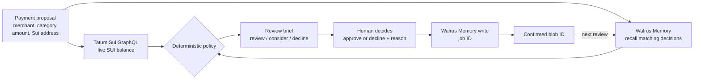

<div align="center">

# SpendMemory

**A Sui payment review that remembers why.**

SpendMemory checks a wallet through Tatum, recalls your past decisions from Walrus Memory, and leaves the final call to you.
Every decision you save becomes memory for the next review. It never sends a payment.

[**Live app**](https://spendmemory.vercel.app/) · [**Verified replay**](https://spendmemory.vercel.app/?replay=1) · [**Source**](https://github.com/0xNexuz/spendmemory)

Built for the [Walrus × Tatum Total Recall hackathon](https://recall-tatum-walrus.vercel.app/)


</div>

---

## Why

People approve the same recurring charges, subscriptions and vendor payments again and again, and the reasoning behind each decision is lost the moment it is made. The next time a similar charge appears, you start from zero.

SpendMemory keeps that reasoning. When you decline an unfamiliar recurring charge and say why, the decision is written to Walrus Memory on Mainnet. The next time the same merchant and category show up, the review brief recalls it and changes its suggestion. You still decide.

## How it works



1. **Propose.** Enter a merchant, category, amount and a public Sui address.
2. **Check.** Tatum returns the live Mainnet SUI balance. Walrus Memory returns past decisions with the exact same merchant and category.
3. **Brief.** A small, deterministic policy turns that evidence into a suggestion: review manually, consider approval, or decline and investigate.
4. **Decide.** A person approves or declines and writes the reason.
5. **Remember.** The decision is written to Walrus Memory on Mainnet. It only counts as confirmed once Walrus returns a blob ID.
6. **Recall.** The next matching review sees that decision, and the suggestion changes.

## Proof on Mainnet

The learning loop has been run against Walrus Mainnet and Sui Mainnet, not a testnet or a mock.

| What | Evidence | Status |
| --- | --- | --- |
| First decision changes a later review | A fictional `DemoCloud subscription` / `software` / 0.02 SUI proposal returned **review**. A **decline** was saved as blob `VpDjzjIwtRW1UQJ8LOrUjUp2rbfV-RaIU36yB8DNSdg`. After a server restart the same proposal returned **decline**, recalling that blob. | Verified 2026-10-28 |
| Hosted write from the public app | The Vercel app evaluated a fictional proposal with Tatum and Walrus both verified, and its write returned blob `M0Xo9ZQKokoCeIxxzh3ZOHC6QlJXGgpuXBCJhL4nKsI`. | Verified 2026-10-28 |
| Memory count | The `spendmemory-mainnet` namespace held **51 confirmed memories** at the hosted check: 1 original demo decision, 49 seeded demo decisions, 1 hosted flow check. The live app reads this count directly from Walrus. | Verified 2026-10-28 |
| Tatum reads | Sui Mainnet balance and transaction queries through Tatum GraphQL, cross-checked against Sui's public GraphQL endpoint. | Verified 2026-10-28 |

> **Honest labelling.** All 51 memories describe **fictional scenarios** written for the demo. The writes are real Mainnet writes with real blob IDs, but they are not decisions from independent users. The 49 seeds are labelled `fictional: true` and their reasons start with "Fictional demo decision". A separate integration-check namespace is excluded from every count.

## Sponsor integrations

| Sponsor | Used for | Where |
| --- | --- | --- |
| **Tatum** | Sui Mainnet GraphQL RPC: live SUI balance for the proposal's wallet, and payment verification. If you paste the digest of a payment you already made, Tatum fetches the transaction and SpendMemory checks that it succeeded, that your wallet paid, and that another address received exactly the proposed SUI. A verified payment is saved with the decision. The API key is sent server-side as `x-api-key`. | [`server/integrations.js`](server/integrations.js), [`server/policy.js`](server/policy.js) |
| **Walrus Memory** | `@mysten-incubation/memwal` SDK: recall decisions, write new ones with an idempotency key, poll write jobs until a blob ID is returned, and list the namespace for the live count. Only the Mainnet relayer is accepted. | [`server/integrations.js`](server/integrations.js), [`server/hosted.js`](server/hosted.js) |

Remove either one and the core loop stops: without Tatum there is no live balance check, and without Walrus there is nothing to recall.

## Safety boundaries

- **No payments, ever.** SpendMemory does not sign, hold keys for, or send transactions. It only reads balances and transactions.
- **Memory advises, people decide.** A recalled approval can only suggest "consider approval". Not having enough SUI is a hard stop that no memory can override.
- **Exact matching only.** Only structured SpendMemory records with the same merchant and category influence a brief, so unrelated memories cannot leak in.
- **One decision per proposal.** Each hosted write carries an idempotency key derived from the proposal, and a proposal that already has a saved decision is refused. A decision is locked while its write is pending; if the outcome is uncertain, the app asks you to check the Walrus account instead of writing a possible duplicate.
- **Signed proposals.** The hosted API only saves decisions for proposals it evaluated itself, using an HMAC-signed ticket that expires after 30 minutes. A verified payment can only enter memory through that ticket, so a browser cannot claim a payment Tatum did not see.
- **Payment checks only add caution.** A payment that does not match can turn "consider approval" into "review", never the other way round.
- **Secrets stay on the server.** Tatum and Walrus credentials live in `.env` locally and in Vercel environment variables when hosted. They are never sent to the browser.

## Two ways to run it

| | Public app on Vercel | Local workspace |
| --- | --- | --- |
| URL | [spendmemory.vercel.app](https://spendmemory.vercel.app/) | `http://127.0.0.1:5173` |
| API | Vercel serverless function, [`api/route.js`](api/route.js) | Express server, [`server/index.js`](server/index.js) |
| Your proposal history | Stored in your browser | Stored in `.local/data.json` (ignored by Git) |
| Confirmed decisions | Shared visitor namespace `spendmemory-user-decisions-v1` | Your own Walrus account and namespace |
| Writes | Open to visitors: 15 per 10 minutes across everyone, 5 per connection, 100 in total | Single local operator |
| Extra | Payment verification, [verified replay](https://spendmemory.vercel.app/?replay=1) of the first learning loop | Transaction lookup, memory trail |

## Run locally

Requires Node.js 20.19+ and npm.

```bash
npm install
cp .env.example .env      # Windows PowerShell: Copy-Item .env.example .env
npm run dev
```

Open `http://127.0.0.1:5173`. The API binds to `127.0.0.1:8787` and Vite proxies `/api` to it.

Create a Mainnet Walrus Memory account and delegate key at [memory.walrus.xyz](https://memory.walrus.xyz/), then fill in `.env`:

| Variable | Purpose |
| --- | --- |
| `TATUM_API_KEY` | Tatum key for Sui Mainnet GraphQL |
| `MEMWAL_PRIVATE_KEY` | Walrus Memory delegate key (server only) |
| `MEMWAL_ACCOUNT_ID` | Walrus Memory account ID |
| `MEMWAL_SERVER_URL` | Must be `https://relayer.memory.walrus.xyz`; other relayers are refused so a testnet write cannot pass as Mainnet proof |
| `MEMWAL_NAMESPACE` | Namespace for decisions, default `spendmemory-mainnet` |
| `MAX_REVIEW_SUI` | Amounts above this always need manual review, default `25` |
| `APP_SIGNING_SECRET` | Hosted API only: signs proposal tickets so a decision can only be saved for a proposal the server evaluated |
| `PORT` | Local API port, default `8787` |

## Scripts

```bash
npm test       # policy, payment reconciliation and hosted API tests (no network needed)
npm run build  # TypeScript check and production bundle
npm run dev    # local API and frontend together
```

## Project structure

```text
api/route.js                 Vercel entry point; wires real integrations into server/hosted.js
server/
  index.js                   Local Express API
  hosted.js                  Public API: tickets, validation, limits, duplicate checks
  integrations.js            Tatum GraphQL and Walrus Memory clients
  policy.js                  Amount parsing, memory matching, recommendation policy, payment reconciliation
  store.js                   Local proposal storage
src/
  LiveApp.tsx                Public app (production homepage)
  PublicDemo.tsx             Verified replay (/?replay=1)
  main.tsx                   Local workspace and routing
  art/                       Hand-drawn artwork, drawn in code
public/art/                  Stippled head images used by the artwork
scripts/seed-demo-memories.mjs  Seeds labelled fictional demo decisions
tests/                       Policy, reconciliation and hosted API tests
```

## Design

The interface is drawn as an inventor's notebook. The hero artwork merges three ideas: sepia gears and ledger boxes for the review rules, a row of stippled heads turning from one review to the next, and the last head wired to pinned clippings of past decisions. Gears, ledger, wires and clippings are drawn in code in [`src/art/`](src/art), so they scale cleanly and animate: wires draw in on load, gears turn slowly, and hovering a clipping lifts it and lights its wire. Motion switches off for visitors who prefer reduced motion.

## Known limitations

- **Open public writes.** Anyone can save a decision from the hosted app. Saves are limited to 15 per 10 minutes across all visitors, counted from the timestamps Walrus keeps for each memory, plus 5 per connection. These checks run just before each write, so a few simultaneous requests can slip past a limit or the 100-memory cap. A Vercel firewall rate-limit rule on `POST /api/route?action=remember` would add a per-IP limit at the edge; it is optional.
- **Shared memory.** Hosted decisions go into one shared Walrus account, so one visitor's decisions influence another visitor's brief for the same merchant and category.
- **Browser-local history.** Hosted proposal history lives in each visitor's browser and does not follow them across devices.
- **User-reported decisions.** Visitor decisions are what the visitor says they decided. Only decisions saved with a verified payment are tied to something that happened on chain.
- **Demo data.** The memories in `spendmemory-mainnet` describe fictional scenarios (see [Proof on Mainnet](#proof-on-mainnet)) and do not affect hosted recommendations.

## Before submission

- [ ] Record a 2–3 minute demo video
- [ ] Publish the blog post
- [ ] Gather eligible submission evidence beyond the fictional demo writes
- [ ] Confirm the special prize wording with the organizers (the event page and the rules describe it differently)

Submission has not been completed.

## Visitor and demo memory separation

The hosted app uses `spendmemory-user-decisions-v1` for visitor recall and writes. Existing examples remain in `spendmemory-mainnet` and do not affect hosted recommendations. The app displays separate visitor and demo counts. Visitor decisions are user-reported unless they were saved with a payment that Tatum verified.
