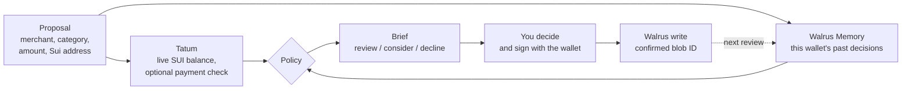

<div align="center">

# SpendMemory

**A Sui payment review that remembers why.**

SpendMemory checks a wallet through Tatum, recalls that wallet's past decisions from Walrus Memory, and leaves the final call to you.
Every decision you save becomes memory for the next review. It never sends a payment.

[**Live app**](https://spendmemory.vercel.app/) · [**Verified replay and ledger**](https://spendmemory.vercel.app/?replay=1) · [**Source**](https://github.com/0xNexuz/spendmemory)

Built by [0xNexuz](https://github.com/0xNexuz) for the [Walrus × Tatum Total Recall hackathon](https://recall-tatum-walrus.vercel.app/)

Saving a decision needs a Sui wallet signature. Tested with **Suiet**; Slush currently shows a "malicious website" warning for the vercel.app address.


</div>

---

## Why

The same charges come back every month, and the reason you approved or declined them last time is gone. SpendMemory keeps that reason on Walrus Mainnet, tied to your wallet, and brings it back the next time the same merchant and category appear.

## How it works



1. **Propose.** Enter a merchant, category, amount and a Sui address. If you already paid, add the transaction digest.
2. **Check.** Tatum returns the live Mainnet balance and, for a digest, confirms the wallet paid exactly that amount. Walrus returns past decisions for the same wallet, merchant and category.
3. **Brief.** A deterministic policy suggests review, consider approval, or decline and investigate.
4. **Decide.** Approve or decline, write why, and sign a short message with the wallet. Signing is free and moves no funds.
5. **Remember.** The server checks the signature and writes the decision to Walrus Mainnet. It counts once Walrus returns a blob ID.
6. **Recall.** The next matching review of that wallet sees the decision, and the suggestion changes.

## Proof on Mainnet

| What | Evidence |
| --- | --- |
| A saved decision changes a later review | A `DemoCloud subscription` / software / 0.02 SUI proposal returned **review**. A **decline** was saved as blob `VpDjzjIwtRW1UQJ8LOrUjUp2rbfV-RaIU36yB8DNSdg`. After a server restart, the same proposal returned **decline**, recalling that blob. [Replay it](https://spendmemory.vercel.app/?replay=1). |
| Every genuine decision since | The [ledger](https://spendmemory.vercel.app/?replay=1#ledger) lists each decision saved through the live app, read live from Walrus: blob ID, outcome, date, whether the wallet signed it, and any payment Tatum verified, linked to Suiscan. |
| Tatum on Sui Mainnet | Balance and transaction queries through Tatum's Sui GraphQL RPC, cross-checked against Sui's public endpoint. |

The 51 memories written while testing (in the `spendmemory-mainnet` namespace) are real Mainnet writes describing fictional scenarios. They are labelled as such and kept apart from visitor decisions, which live in `spendmemory-user-decisions-v1`.

## Sponsor integrations

| Sponsor | Used for |
| --- | --- |
| **Tatum** | Sui Mainnet GraphQL RPC for the wallet's live SUI balance, and for fetching a payment transaction to check it succeeded, came from this wallet and paid exactly the proposed amount. |
| **Walrus Memory** | `@mysten-incubation/memwal` on the Mainnet relayer only: recall, writes with an idempotency key, job polling until a blob ID, and the namespace listing behind the live counts and ledger. |

Without Tatum there is no balance or payment check; without Walrus there is nothing to recall.

## Privacy and safety

- **No payments.** SpendMemory never builds, signs or sends a transaction.
- **Memory advises, you decide.** A remembered approval can only suggest "consider approval". Not enough SUI is a hard stop.
- **Your memory is yours.** Decisions are stored with a hash of the wallet address and only affect that wallet's reviews. Saving needs the wallet's signature over the exact wallet, proposal, decision and reason, verified on the server with `@mysten/sui` (zkLogin included).
- **Reasons stay private.** Anyone can review a public address, but the brief only shows how many past decisions matched and whether they were approvals or declines. The reasons come back only after the wallet's owner signs to view them. The public ledger never shows merchant names, reasons or wallet keys.
- **No duplicates or replays.** Each proposal is saved at most once; the server's signed ticket expires after 30 minutes, and a signature cannot be reused for another decision.
- **Limits.** Saves are capped at 15 per 10 minutes across all visitors, 5 per connection, and 100 in total.
- **Secrets stay on the server.** Tatum and Walrus credentials are server-side only.

## Run locally

Requires Node.js 20.19+.

```bash
npm install
cp .env.example .env      # Windows PowerShell: Copy-Item .env.example .env
npm run dev               # API on 127.0.0.1:8787, app on http://127.0.0.1:5173
npm test                  # policy, payment, signature and API tests, no network needed
npm run build             # type check and production bundle
```

Create a Mainnet Walrus Memory account and delegate key at [memory.walrus.xyz](https://memory.walrus.xyz/), then fill in `.env`:

| Variable | Purpose |
| --- | --- |
| `TATUM_API_KEY` | Tatum key for Sui Mainnet GraphQL |
| `MEMWAL_PRIVATE_KEY`, `MEMWAL_ACCOUNT_ID` | Walrus Memory delegate key and account (server only) |
| `MEMWAL_SERVER_URL` | Must be `https://relayer.memory.walrus.xyz` |
| `MEMWAL_NAMESPACE` | Local namespace, default `spendmemory-mainnet` |
| `MAX_REVIEW_SUI` | Amounts above this always need manual review, default `25` |
| `APP_SIGNING_SECRET` | Hosted API only: signs proposal tickets |

## Project structure

```text
api/route.js            Vercel entry: real Tatum, Walrus and signature checks wired into server/hosted.js
server/hosted.js        Public API: evaluate, signed save, signed reasons, proof ledger, limits
server/save-message.js  The exact messages a wallet signs (shared with the browser)
server/policy.js        Amount parsing, memory matching, policy, payment reconciliation
server/integrations.js  Tatum GraphQL and Walrus Memory clients
server/index.js         Local single-operator API
src/LiveApp.tsx         Public app
src/PublicDemo.tsx      Verified replay; src/ProofList.tsx is its live ledger
src/wallet/             Wallet connect and signing (@mysten/dapp-kit-react, loaded on demand)
src/art/                The notebook artwork, drawn in code
tests/                  Policy, reconciliation and hosted API tests
```

## Known limitations

- Visitor decisions are what the visitor says they decided, unless saved with a payment Tatum verified.
- Proposal history in the hosted app lives in each browser and does not follow you across devices.
- The two decisions saved before wallet signing existed are not tied to a wallet and no longer affect any brief.
- The save limits are checked just before each write, so a few simultaneous requests can slip past one.
- Slush flags `spendmemory.vercel.app` as a malicious website, although the site is not on the public Sui wallet blocklist. Suiet works; a custom domain would likely clear the warning.
